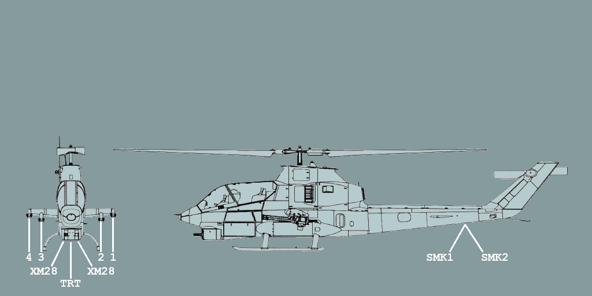
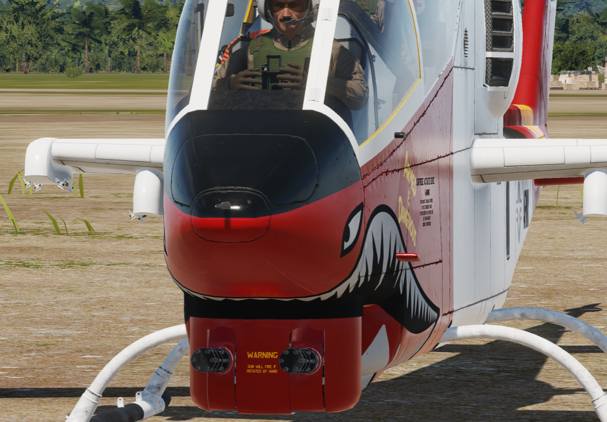
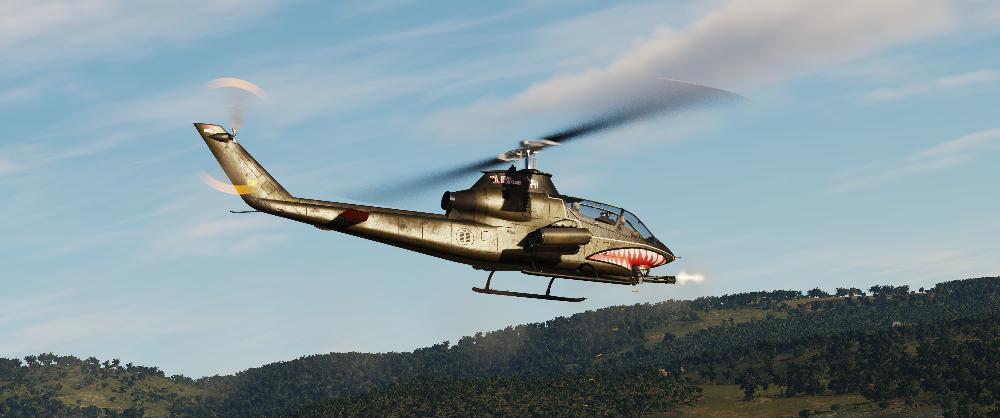

# AH-1G Weapon Systems Overview

The AH-1G carries a variety of weapons, to perform COIN, CAS, or a selection of other missions. Selecting the right loadouts for your targets will assist mission success.

*An AH-1G loaded with the XM197 20mm Turret and 4x XM159 17lb FFAR Rocket Pods*
---

 TODO make this better

## Wing Pylons

The AH-1G has 4 wing mounted pylons, 2 on each side.

### Rockets

#### MK-4 High-Explosive

The 6 pound HE: The MK-4 (shown below) was the very first 2.75 inch rocket and called the Mighty Mouse. It was used in the 1950's on fast movers as an air to air weapon. It was 1.2 m (4 ft), and it weighed 8.4 kg (18.5 lb). Maximum range was around 6000 m (6500 yds), but effective range was more like 3400 m (3700 yds).

#### M151 High-Explosive

The 10 pounder HE: is an antipersonnel and antimaterial warhead. The bursting radius is 10 meters; however, the high velocity fragments can often increase the lethality radius in excess of 50 meters. The nose section is constructed of cast iron and threaded to receive the fuze. The base section is constructed of steel or cast iron and is threaded so that it can be attached to the rocket motor. The base section and the rocket motor are brazed together. Total weight of the loaded, unfuzed, warhead is 8.7 pounds, of which 2.3 pounds is composition B4 explosive.

#### M229 High-Explosive

The 17 pounder HE: M229 High-Explosive. Is an elongated version of the M151. The filler consists of 4.8 pounds of composition B4 explosive and can use the same fuzes as the M151. Its unfuzed weight is 16.4 pounds.

#### WDU-4A/A Flechettes

The 10 pounder Flechette: WDU (4A/A). Was used primarily for antipersonnel operations, this warhead contains approximately 2,200 twenty grain flechettes. The flechettes are released by a base-mounted, fuze-ignited (integral fuze) expulsion charge at rocket motor burnout. Fuzed weight of the flechette is 9.3 pounds.

#### M156 White Phosphorus

White Phosphorous/Smoke. "Willie Pete". Primarily used for target marking and incendiary purposes. Similar construction to the HE warhead but contains 2.2 pounds of WP with .12-pound bursting charge of composition B. Weight of the fuzed warhead is about 9.7 pounds.

!!! Note
    Weapon Information sourced from https://www.centaursinvietnam.org/History/ihistoryEqOrdRocket.html

---

### Miniguns {: .TODO-section }

#### XM35 20mm {: .TODO-section }

#### XM18 7.62mm {: .TODO-section }

### Bombs {: .TODO-section }

#### MK-82 Low Drag {: .TODO-section }

## Turrets

Our cobra reproduction features several Turret options, including a mix of regular service weapons, and some test loadouts.

### XM28 Turret

The XM28 is capable of housing 2 weapons, with 2 options per slot. This Turret is the standard issue on the G model Cobra.

*XM28 Turret equipped with 2x M134 7.62 Miniguns*

The available options are as follows:  

| Name | Type | notes |
| -----| -------- | ---------|
| M134 | 7.62mm Minigun | Compatible with XM28 turret, up to 2 available |
| M129 | 40mm Grenade Launcher | Compatible with XM28 turret, up to 2 available |

---

### XM195 Turret

The XM195 is a 20x102mm 6 barrel minigun, housing 950 rounds.

*AH-1G equipped with an XM195 turret straffing ground targets*

---

### XM197 Turret

The XM197 is a 20x102mm 3 barrel minigun, housing 950 rounds.

*AH-1G equipped with an XM197 turret straffing ground targets*

---

### GE430

The GE430 shoots 30x173mm rounds, with a capacity of 80 rounds.

*GE430 equipped Cobra breaks away from the camera ship*

---

## Smoke Grenades {: .TODO-section }

